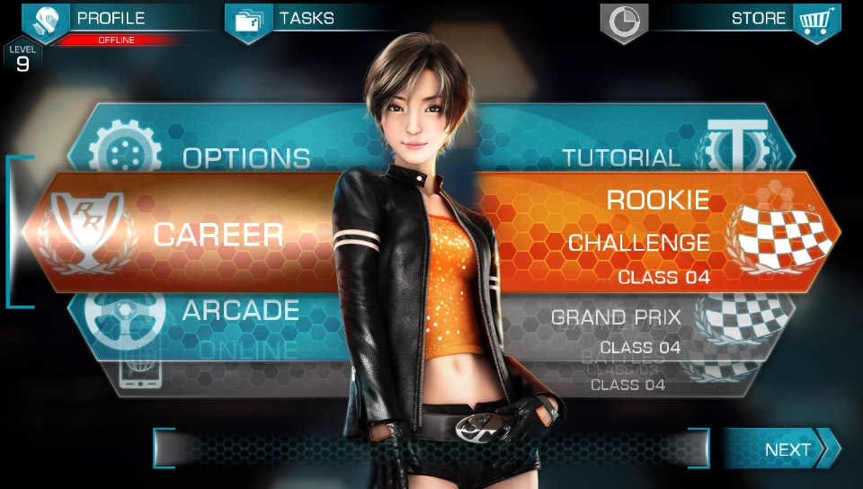
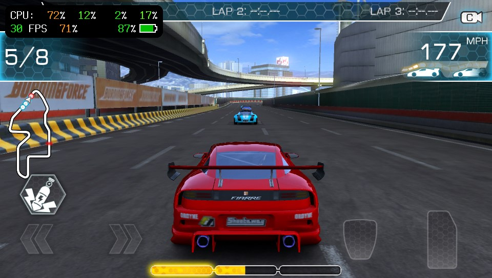
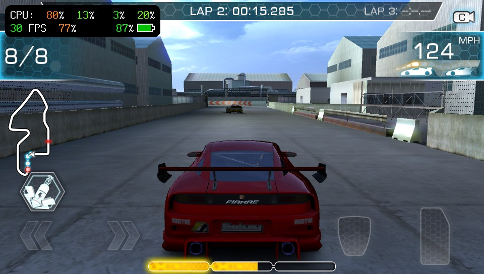
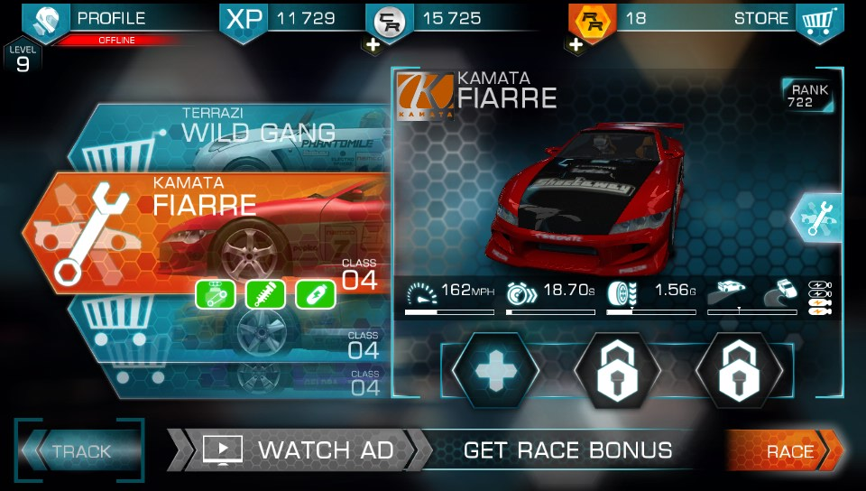

# Ridge Racer Slipstream Vita

<p align="center"></p>

This is a wrapper/port of <b>Ridge Racer Slipstream</b> for the *PS Vita*.

The port works by loading the official Android ARMv7 executables in memory, resolving its imports with native functions and patching it in order to properly run.
By doing so, it's basically as if we emulate a minimalist Android environment in which we run natively the executable as is.

<p align="center">
  
  
  
</p>

## Changelog

### v.1.0

- Initial release.
- Physical controls: left stick / D-pad to steer, L to brake, R (or Square) for nitro; menus can be fully navigated with the D-pad / left stick, including the rolling menu wheels.
- Menus run at 60 FPS and races at a steady 30 FPS on most tracks (frame pacing avoids the judder of alternating between 30 and 60 FPS).
- The game's engine is compiled without optimizations: its hottest rendering and loading functions were rewritten in C or redirected to optimized code (zlib, libpng and libdeflate from the SDK), roughly doubling the race framerate.
- Greatly reduced loading times: the OBB is opened once and read through a shared cache, and race loads are recorded so the next load of the same track reads its data ahead in the background (race loads went from about a minute to 20-30 seconds).
- Fixed speckled textures on distant foliage and buildings (vitaGL regenerated the game's mipmaps with a wrong format).
- Fixed a crash when switching menus with the physical controls (the game un-focused an already deleted menu item).
- Social network buttons (Facebook, Google Play, Game Center, share), which can't work on the Vita, are hidden.

## Notes and Tips

- Online features (online races, challenges, friends, leaderboards and achievements) don't work.
- The first time a track is loaded is slower: that load is recorded in `ux0:data/ridgeracer/prefetch.bin` and the following loads of the same track are faster. Deleting the file only makes the next load of each track slow again.
- The very first time each shader is used there can be a small stutter while it is compiled; compiled shaders are cached in `ux0:data/shader_cache/RRSS00001/`.
- If the car steers by itself, check the game's control settings: a tilt control scheme may be selected.
- Default controls:

| Vita | Action |
|---|---|
| Left stick / D-pad | Steer / navigate menus |
| Right stick | Rotate menu wheels |
| L | Brake |
| R / Square | Nitro |
| Cross | Confirm |
| Circle | Back |
| Start | Pause |
| Select | Android "Back" |
| Touch screen | Touch controls |
| Tilting the Vita | Tilt steering (if selected in the game's settings) |

- Optional settings can be written to `ux0:data/ridgeracer/config.txt`, one `name value` per line (e.g. `msaa 1`):

| Option | Default | Meaning |
|---|---|---|
| `msaa` | `1` | Anti-aliasing: `0` off, `1` 2x, `2` 4x (too heavy for the GPU) |
| `framepacing` | `1` | `1` steady 30 FPS when 60 can't be held, `0` plain vsync, `2` always 30 |
| `prefetch` | `1` | Record race loads and read their data ahead next time |
| `obbcache` | `1` | Read the OBB through one shared handle with a small cache |
| `fastpath` | `1` | Optimized replacements for hot game functions |
| `rewrite` | `1` | C rewrites of the big render / load functions |
| `libpng` | `1` | Decode PNGs with the SDK's optimized libpng |
| `deflate` | `1` | Decompress the OBB data with libdeflate |
| `cores` | `1` | Pin the game's threads to the Vita's CPU cores |
| `social` | `0` | `1` shows the (non-working) social network buttons again |

## Setup Instructions (For End Users)

In order to properly install the game, you'll have to follow these steps precisely:

- Install [kubridge](https://github.com/bythos14/kubridge/releases/) by copying `kubridge.skprx` to your taiHEN plugins folder (usually `ux0:tai`) and adding an entry to your `config.txt` under `*KERNEL`:

```
  *KERNEL
  ux0:tai/kubridge.skprx
```

- Install `libshacccg.suprx`, if you don't have it already, by following [this guide](https://samilops2.gitbook.io/vita-troubleshooting-guide/shader-compiler/extract-libshacccg.suprx).
- Obtain your copy of *Ridge Racer Slipstream* **v2.5.4** legally for Android in form of an `.apk` file and an obb (`main.2319.com.namcobandaigames.ridgeracerss.obb`). [You can get all the required files directly from your phone](https://stackoverflow.com/questions/11012976/how-do-i-get-the-apk-of-an-installed-app-without-root-access) or by using an apk extractor you can find in the play store. Other versions won't work.
- Open the apk with your zip explorer and extract `lib/armeabi-v7a/libRidgeRacer.so`, `lib/armeabi-v7a/libfmodex.so` and `lib/armeabi-v7a/libfmodevent.so` to `ux0:data/ridgeracer`.
- From the same apk, extract the `assets` folder to `ux0:data/ridgeracer` (so you get `ux0:data/ridgeracer/assets`).
- Copy the obb to `ux0:data/ridgeracer` and rename it to `main.obb` (don't extract it).
- Install the `ridgeracer_slipstream.vpk` from the Release page.

You should end up with:

```
ux0:data/ridgeracer/
├── assets/
├── libfmodevent.so
├── libfmodex.so
├── libRidgeRacer.so
└── main.obb
```

## Build Instructions (For Developers)

In order to build the loader, you'll need a [vitasdk](https://github.com/vitasdk) build fully compiled with softfp usage.

The required libraries ([so_util](https://github.com/Rinnegatamante/so_util), [FalsoJNI](https://github.com/v-atamanenko/FalsoJNI), [FalsoNDK](https://github.com/elliencode/FalsoNDK), [vitaGL](https://github.com/Rinnegatamante/vitaGL) and [libdeflate](https://github.com/ebiggers/libdeflate)) are included in the `lib` folder with the small fixes this port needs, and vitaGL is built automatically.

After all these requirements are met, you can compile the loader with the following commands:

```bash
mkdir build && cd build
cmake .. -DCMAKE_BUILD_TYPE=Release -DVITA3K_BUILD=OFF && make
```

Optional CMake flags: `-DVITA3K_BUILD=ON` builds for the Vita3K emulator (software ETC1 textures; it is the default, use `OFF` for real hardware) and `-DPERF_PROFILE=ON` writes frame and loading timings to `ux0:data/ridgeracer/perf.txt`.

vitaGL is built in place in `lib/vitagl`: when switching between builds with different vitaGL flags (Vita3K / real hardware), delete `vitagl_flags.stamp` in the build folder so vitaGL is rebuilt.

## Credits

- gl33ntwine (Volodymyr Atamanenko) for [soloader-boilerplate](https://github.com/v-atamanenko/soloader-boilerplate), the base this port was built on, and for [FalsoJNI](https://github.com/v-atamanenko/FalsoJNI).
- TheFloW for the original .so loader.
- Rinnegatamante for [so_util](https://github.com/Rinnegatamante/so_util) and [vitaGL](https://github.com/Rinnegatamante/vitaGL).
- elliencode for [FalsoNDK](https://github.com/elliencode/FalsoNDK).
- bythos14 for [kubridge](https://github.com/bythos14/kubridge).
- Eric Biggers for [libdeflate](https://github.com/ebiggers/libdeflate).

## License

The port's code is released under the MIT license (see [LICENSE](LICENSE)), like the boilerplate it is based on. Bundled libraries keep their own licenses (vitaGL: LGPL-3.0, see `lib/vitagl/COPYING*`; FalsoNDK: Apache-2.0; libdeflate: MIT, see `lib/libdeflate/COPYING`).
